<p align="center">

</p>

<h1 align="center">Catch .env secrets leaking into git</h1>

<p align="center">Your own values, not lookalikes · Staged, tracked or in the history · Offline,&nbsp;never&nbsp;printed</p>

<p align="center">
<a href="https://pypi.org/project/omerta/"></a>
<a href="https://pypi.org/project/omerta/"></a>
<a href="https://github.com/shcherbak-ai/omerta/actions/workflows/ci.yml"></a>
<a href="https://github.com/shcherbak-ai/omerta/actions/workflows/ci.yml"></a>
</p>

<p align="center">
<a href="https://www.producthunt.com/products/omerta?embed=true&utm_source=badge-featured&utm_medium=badge&utm_campaign=badge-omerta"></a>
</p>

<p align="center">
<a href="#quick-start"><strong>Quick start</strong></a> ·
<a href="#git-hooks"><strong>Git hooks</strong></a> ·
<a href="#ci"><strong>CI</strong></a> ·
<a href="#configuration"><strong>Configuration</strong></a> ·
<a href="CHANGELOG.md"><strong>Changelog</strong></a> ·
<a href="SECURITY.md"><strong>Security</strong></a>
</p>

<p align="center">
<br>
<sup>Illustrative: omerta names the variable, never the value.</sup>
</p>

Pattern scanners such as gitleaks and TruffleHog find what looks like a key; omerta finds *your* keys. It reads the values of your env files and fails when one is in git, as written or encoded in URLs, JSON and base64, so it catches secrets of any format: a small provider's key, a cloud bucket's name, an organisation ID. It runs entirely offline.

## Quick start

```bash
uvx omerta check --all    # every tracked file
uvx omerta history        # every commit, tag and message
```

[uv](https://docs.astral.sh/uv/) brings its own Python; with pip, `pip install omerta`. Values that are not secrets, such as `DB_HOST=localhost` and `DB_USER=postgres`, are found too: leave them out in `.omerta.toml`:

```toml
ignore = ["DB_HOST", "DB_USER"]
```

## Git hooks

`omerta check` searches the staged changes. With [pre-commit](https://pre-commit.com):

```yaml
# .pre-commit-config.yaml
repos:
  - repo: https://github.com/shcherbak-ai/omerta
    rev: v0.1.1
    hooks:
      - id: omerta
```

The hook runs on pre-commit's own Python, which must be 3.11 or later: install pre-commit with `uv tool install pre-commit` or Homebrew, not from Ubuntu 22.04's apt or into macOS's system Python.

<details>
<summary>Husky, Lefthook, a plain git hook, or omerta pinned in your lockfile</summary>

```bash
# .husky/pre-commit, or .git/hooks/pre-commit (made executable)
uvx omerta@0.1.1 check
```

```yaml
# lefthook.yml
pre-commit:
  commands:
    omerta:
      run: uvx omerta@0.1.1 check
```

In a Python project, `uv add --dev omerta`, and a local pre-commit hook:

```yaml
repos:
  - repo: local
    hooks:
      - id: omerta
        name: omerta
        entry: uv run omerta check
        language: system
        types: []
        types_or: [file, symlink]
```

</details>

## CI

CI has no `.env` to take values from, so there omerta finds the env files that were committed:

```yaml
# .github/workflows/omerta.yml
name: omerta
on: [push, pull_request]
permissions:
  contents: read
jobs:
  omerta:
    runs-on: ubuntu-latest
    timeout-minutes: 10
    steps:
      - uses: actions/checkout@v7
        with:
          fetch-depth: 0  # all of the history
      - uses: astral-sh/setup-uv@v10
      - run: uvx omerta@0.1.1 check --all
      - run: uvx omerta@0.1.1 history
```

## What it finds

```bash
omerta check           # the staged changes, as git holds them
omerta check PATH      # the tracked files at or under PATH
omerta check --all     # every tracked file
omerta history         # every file version and message reachable from a branch, a tag or HEAD
```

- **Values** come from `.env` and `.env.*` at the root that git does not track. Templates (`*.example`, `*.sample`, `*.template`) are skipped.
- **A tracked env file** is a leak in itself.
- **Each value** is searched as written, percent-encoded, JSON-escaped and base64-encoded, in text, binary files and file names.
- **`history`** reports a value at the commit where it enters a file.
- **A rotated key** is no longer in your `.env`, so `history` no longer looks for it. To find the old one, put it in another untracked env file, such as `.env.old`: findings then say `(from .env.old)`.
- **Values under 8 characters** (`true`, `5432`) are skipped. For a shorter secret, lower `min-chars`, and `ignore` what then matches ordinary text.

## Output

```text
src/client.py:12: OPENAI_API_KEY (from .env)          # check
<commit> src/client.py: OPENAI_API_KEY (from .env)    # history
<commit> (message): OPENAI_API_KEY (from .env)        # a commit or tag message
infra/<BUCKET>.json (path): BUCKET (from .env)        # a value in a name
.env.production: tracked env file
```

A value is never printed: in a name, its variable stands in its place. The exit code is `0` when nothing is found, `1` when something is, and `2` on an error. `--json` writes JSON Lines, with the form each value was found in.

## Configuration

Settings go in `.omerta.toml` at the root of the repository, or in `[tool.omerta]` of `pyproject.toml`:

```toml
# .omerta.toml
env-files = [".env.local", ".env.*.local"]
ignore = ["DB_HOST", "DB_USER"]
```

Each setting has an option, which overrides it for one run, except `--ignore`, which adds to it. `-C PATH` goes before the command, as in git:

```bash
omerta check --all --ignore DB_HOST --ignore DB_USER
omerta -C ../api history --env-file .env.local --json
```

| Option | Setting and default | What it does |
| --- | --- | --- |
| `--env-file PATTERN` | `env-files = [".env", ".env.*"]` | The env files to take values from |
| `--ignore NAME` | `ignore = []` | Variables not searched for |
| `--min-chars N` | `min-chars = 8` | The shortest value searched for |
| `--encoded`,<br>`--no-encoded` | `encoded = true` | Also search URL, JSON and base64 forms |
| `--json` | | Findings as JSON Lines |
| `-q`, `--quiet` | | Only the exit code and errors |
| `-C PATH` | | Run as if started in `PATH` |

`--env-file` and `--ignore` can be given more than once. Patterns are relative to the root of the repository, and `**` matches any folders.

A project that commits an env file on purpose (Symfony's `.env`, Vite's `.env.production`, dotenvx) lists in `env-files` only those that hold its secrets, as in the example above.

## Requirements and security

- **git 2.31** or later on `PATH`, and **2.45** in a partial clone, the first that can be kept from fetching. A CI container whose user does not own the checkout needs `git config --global --add safe.directory "$PWD"`.
- **Python 3.11** or later, which `uvx` brings along. On Windows on ARM, use an x64 Python: hyperscan, which omerta searches with, has no wheels for Windows on ARM.
- **Security:** its two dependencies are pinned to exact versions, and git is run by its absolute path, never from inside the repository it checks, and is never given a value on its command line. See [SECURITY.md](SECURITY.md).

## License

[MIT](LICENSE)

<p align="center"></p>

## More from shcherbak_ai

<!-- markdownlint-disable MD033 -->
<table>
  <tr>
    <td width="36%" align="center"><a href="https://github.com/shcherbak-ai/contextgem"></a></td>
    <td>Structured extraction from documents with LLMs.</td>
  </tr>
  <tr>
    <td width="36%" align="center"><a href="https://github.com/shcherbak-ai/licenseal"></a></td>
    <td>License compatibility checks for dependency trees, fast enough for CI.</td>
  </tr>
  <tr>
    <td width="36%" align="center"><a href="https://github.com/shcherbak-ai/tethered"></a></td>
    <td>Runtime network egress control for Python.</td>
  </tr>
</table>
<!-- markdownlint-enable MD033 -->

Questions or collaboration ideas? Reach out on [LinkedIn](https://www.linkedin.com/in/sergii-shcherbak-10068866/) or [X](https://x.com/seshch). Built with ❤️ in Oslo, Norway.
